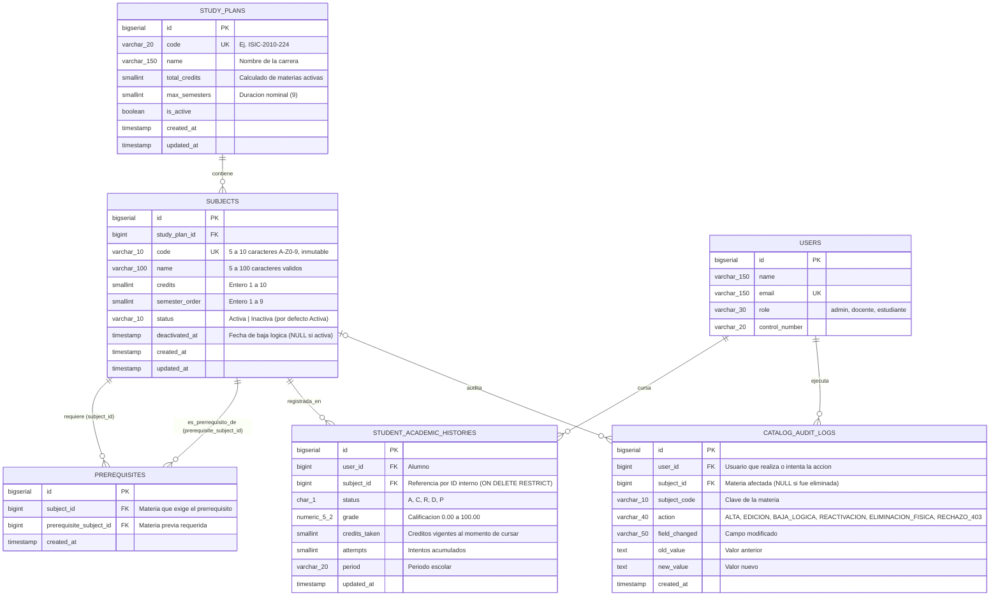
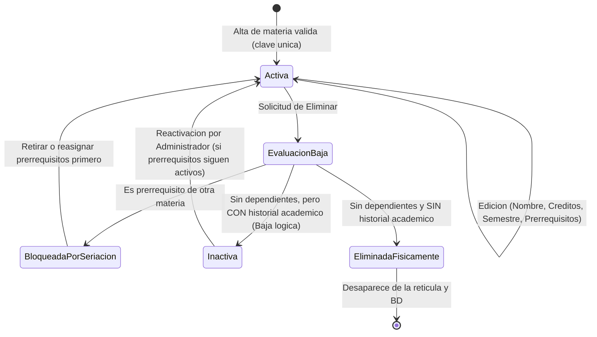

# Diseño de la Pantalla de Administración del Catálogo y Modelo de Datos de la Materia
**Proyecto RISA — Retícula Interactiva de Seguimiento Académico**

---

### Encabezado Institucional y de Control Documental

| Campo | Detalle |
| :--- | :--- |
| **Proyecto** | RISA (Retícula Interactiva de Seguimiento Académico) |
| **Documento** | Especificación de Diseño de Interfaz y Modelo de Datos del Catálogo de Materias |
| **Versión** | v1.0.0 |
| **Fecha de Creación / Actualización** | 28 de octubre de 2026 |
| **Autor(es)** | Velazquez Teran Adrian Esteban, Zamora Martinez Samuel |
| **Organización / Carrera** | Instituto Tecnológico de Celaya — Ingeniería en Sistemas Computacionales |
| **Asignatura** | Gestión de Proyectos de Software (Grupo A) |
| **Docente** | Elda Ramirez Gonzalez |
| **Entregables Vinculados** | [`MockupCatalogoMaterias_v1_2026-10-28.html`](../MockupCatalogoMaterias_v1_2026-10-28.html), [`diagrama_modelo_materia.png`](./diagrama_modelo_materia.png) |

---

## 1. Modelo de Datos de la Materia

El modelo relacional en PostgreSQL 16 garantiza la integridad referencial del catálogo, la unicidad permanente de las claves de asignatura, la prevención de pérdida de historial académico mediante baja lógica y la conservación de los créditos históricos con los que un alumno cursó cada materia.

### 1.1 Diagrama Entidad-Relación (ERD)



---

### 1.2 Diccionario de Datos de la Entidad `subjects` (Materia) y Tablas Relacionadas

#### Tabla principal: `subjects`

| Columna | Tipo PostgreSQL | Nulo | Restricciones y Reglas de Negocio |
| :--- | :--- | :--- | :--- |
| `id` | `BIGSERIAL` | No | `PRIMARY KEY`. Identificador interno inmutable referenciado por el historial académico. |
| `study_plan_id` | `BIGINT` | No | `FOREIGN KEY REFERENCES study_plans(id) ON DELETE RESTRICT`. |
| `code` | `VARCHAR(10)` | No | `UNIQUE (study_plan_id, code)`, `CHECK (code ~ '^[A-Z0-9]{5,10}$')`. Inmutable tras el alta; nunca se reutiliza aunque la materia pase a inactiva. |
| `name` | `VARCHAR(100)` | No | `CHECK (char_length(trim(name)) BETWEEN 5 AND 100)`. Admite letras con acentos, dígitos, espacios y signos `. , - ( )`, sin permitir solo números. |
| `credits` | `SMALLINT` | No | `CHECK (credits BETWEEN 1 AND 10)`. Número entero sin decimales. |
| `semester_order` | `SMALLINT` | No | `CHECK (semester_order BETWEEN 1 AND 9)`. Posición semestral dentro de la retícula oficial. |
| `status` | `VARCHAR(10)` | No | `DEFAULT 'Activa'`, `CHECK (status IN ('Activa', 'Inactiva'))`. Controla la baja lógica. |
| `deactivated_at` | `TIMESTAMP` | Sí | Registra la marca temporal cuando la materia pasa a `Inactiva`. |
| `created_at` | `TIMESTAMP` | No | Fecha de creación del registro. |
| `updated_at` | `TIMESTAMP` | No | Fecha de última modificación del registro. |

#### Tabla de seriación: `prerequisites`

| Columna | Tipo PostgreSQL | Nulo | Restricciones y Reglas de Negocio |
| :--- | :--- | :--- | :--- |
| `id` | `BIGSERIAL` | No | `PRIMARY KEY`. |
| `subject_id` | `BIGINT` | No | `FOREIGN KEY REFERENCES subjects(id) ON DELETE CASCADE`. Materia que tiene el requisito. |
| `prerequisite_subject_id` | `BIGINT` | No | `FOREIGN KEY REFERENCES subjects(id) ON DELETE RESTRICT`. Impide eliminar físicamente una materia si otra depende de ella. |
| *(Restricción de tabla)* | — | — | `UNIQUE (subject_id, prerequisite_subject_id)` y `CHECK (subject_id <> prerequisite_subject_id)`. El validador de dominio verifica además ausencia de ciclos en el grafo y que `prerequisite.semester_order < subject.semester_order`. |

#### Conservación de créditos en historial: `student_academic_histories`

Para atender la regla de la sección 5.2 y sección 8 del análisis (*"Las calificaciones ya registradas conservan los créditos con que se cursó la materia"*), la tabla `student_academic_histories` incorpora la columna `credits_taken SMALLINT NOT NULL` y la llave foránea hacia `subjects(id)` se declara con `ON DELETE RESTRICT`. De este modo:
1. La base de datos bloquea a nivel motor cualquier intento de `DELETE` físico sobre una materia que posea registros en el historial.
2. Si el administrador edita el campo `credits` de una materia en el catálogo, las acreditaciones históricas conservan intacto su valor en `credits_taken`, mientras que las recomendaciones y proyecciones futuras leen `subjects.credits`.

---

### 1.3 Definición SQL (DDL PostgreSQL 16)

```sql
CREATE TABLE subjects (
    id BIGSERIAL PRIMARY KEY,
    study_plan_id BIGINT NOT NULL REFERENCES study_plans(id) ON DELETE RESTRICT,
    code VARCHAR(10) NOT NULL,
    name VARCHAR(100) NOT NULL,
    credits SMALLINT NOT NULL,
    semester_order SMALLINT NOT NULL,
    status VARCHAR(10) NOT NULL DEFAULT 'Activa',
    deactivated_at TIMESTAMP NULL,
    created_at TIMESTAMP NOT NULL DEFAULT CURRENT_TIMESTAMP,
    updated_at TIMESTAMP NOT NULL DEFAULT CURRENT_TIMESTAMP,
    CONSTRAINT uq_subjects_plan_code UNIQUE (study_plan_id, code),
    CONSTRAINT chk_subjects_code_format CHECK (code ~ '^[A-Z0-9]{5,10}$'),
    CONSTRAINT chk_subjects_name_length CHECK (char_length(trim(name)) BETWEEN 5 AND 100),
    CONSTRAINT chk_subjects_credits_range CHECK (credits BETWEEN 1 AND 10),
    CONSTRAINT chk_subjects_semester_range CHECK (semester_order BETWEEN 1 AND 9),
    CONSTRAINT chk_subjects_status CHECK (status IN ('Activa', 'Inactiva'))
);

CREATE TABLE prerequisites (
    id BIGSERIAL PRIMARY KEY,
    subject_id BIGINT NOT NULL REFERENCES subjects(id) ON DELETE CASCADE,
    prerequisite_subject_id BIGINT NOT NULL REFERENCES subjects(id) ON DELETE RESTRICT,
    created_at TIMESTAMP NOT NULL DEFAULT CURRENT_TIMESTAMP,
    CONSTRAINT uq_prerequisite_pair UNIQUE (subject_id, prerequisite_subject_id),
    CONSTRAINT chk_no_self_prerequisite CHECK (subject_id <> prerequisite_subject_id)
);
```

---

## 2. Diagrama de Estados y Flujo de Eliminación / Baja Lógica

El ciclo de vida de una materia dentro del catálogo responde a la presencia de dependencias de seriación y registros en el historial académico:



---

## 3. Especificación de la Pantalla de Administración del Catálogo

La maqueta funcional interactiva se encuentra en [`MockupCatalogoMaterias_v1_2026-10-28.html`](../MockupCatalogoMaterias_v1_2026-10-28.html) y está integrada en la ruta `/catalogo-materias`.

### 3.1 Componentes de la Vista Principal
1. **Indicadores Superiores**:
   - Conteo en tiempo real de materias `Activas`, materias `Inactivas` (en baja lógica), suma total de créditos del plan activo y rango normativo vigente (`1–10 créditos / Semestres 1–9`).
2. **Barra de Búsqueda y Filtros**:
   - Búsqueda instantánea por clave o nombre (insensible a mayúsculas/minúsculas y espacios repetidos).
   - Selector de filtro por semestre (`1` al `9`) y selector de estatus (`Activa` / `Inactiva`).
3. **Tabla del Catálogo**:
   - Muestra para cada registro: `Clave`, `Nombre` (con subtítulo de trazabilidad que indica cuántos alumnos tienen historial en la materia y de qué asignaturas es prerrequisito), `Semestre`, `Créditos`, chips de `Prerrequisitos`, etiqueta de `Estatus` y botones de acción (`Editar`, `Eliminar` o `Reactivar`).

### 3.2 Formulario Modal de Alta y Edición (`#dlg-form`)
- **Normalización previa**: Elimina espacios al inicio y final (`trim`), colapsa espacios múltiples internos y convierte la clave a mayúsculas automáticamente.
- **Inmutabilidad de clave en edición**: En modo Alta el campo `Clave` está habilitado; en modo Edición queda bloqueado (`readonly`) para impedir rupturas de referencias históricas.
- **Mensajes de error implementados**:
  - Campo vacío: `El campo [Clave | Nombre | Créditos | Semestre] es obligatorio.`
  - Formato de clave: `La clave debe tener de 5 a 10 caracteres entre letras mayúsculas y números, sin espacios.`
  - Duplicidad de clave (activa o inactiva): `Ya existe una materia con la clave [clave].`
  - Nombre inválido: `El nombre debe tener entre 5 y 100 caracteres válidos y no puede contener solo números.`
  - Rango de créditos: `Los créditos deben ser un número entero entre 1 y 10.`
  - Rango de semestre: `El semestre debe ser un número entero entre 1 y 9.`
  - Seriación inválida o cíclica: `El prerrequisito seleccionado genera una dependencia circular o no es válido.`
- **Confirmaciones preventivas**:
  - Cuando coinciden nombre y semestre con otra materia distinta.
  - Cuando en modo edición se modifican los créditos o el semestre de la materia.

### 3.3 Diálogo de Confirmación para Eliminar y Baja Lógica (`#dlg-eliminar`)
El diálogo evalúa automáticamente el estado relacional de la materia seleccionada y presenta una de las tres vistas:
1. **Bloqueo por prerrequisito**: Si al menos una materia depende de ella, muestra alerta de error con el mensaje exacto `No se puede eliminar: es prerrequisito de [lista de materias].` y oculta el botón destructivo.
2. **Transición a Baja Lógica**: Si no es prerrequisito de otra materia pero cuenta con alumnos en su historial académico, bloquea el borrado físico, informa `La materia tiene historial académico; solo puede darse de baja.` y habilita el botón `Confirmar baja lógica`. Al confirmar, cambia el estatus a `Inactiva` y notifica `Materia dada de baja. El historial no se modificó.`
3. **Confirmación de Eliminación Física**: Si no tiene dependientes ni historial académico, solicita confirmación explícita con el botón `Eliminar definitivamente`. Al confirmar, remueve el registro y muestra `Materia eliminada correctamente.`
